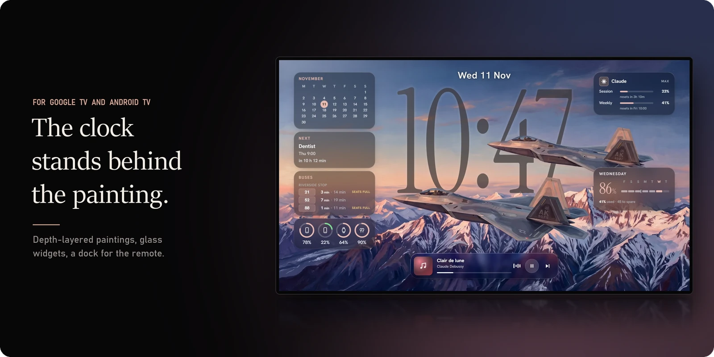
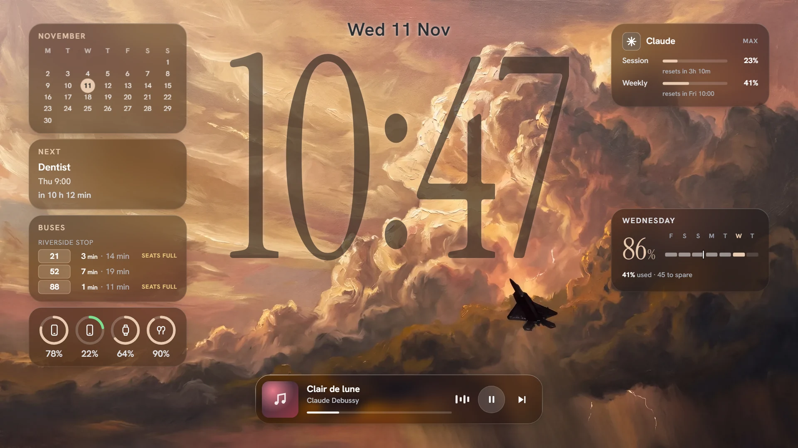
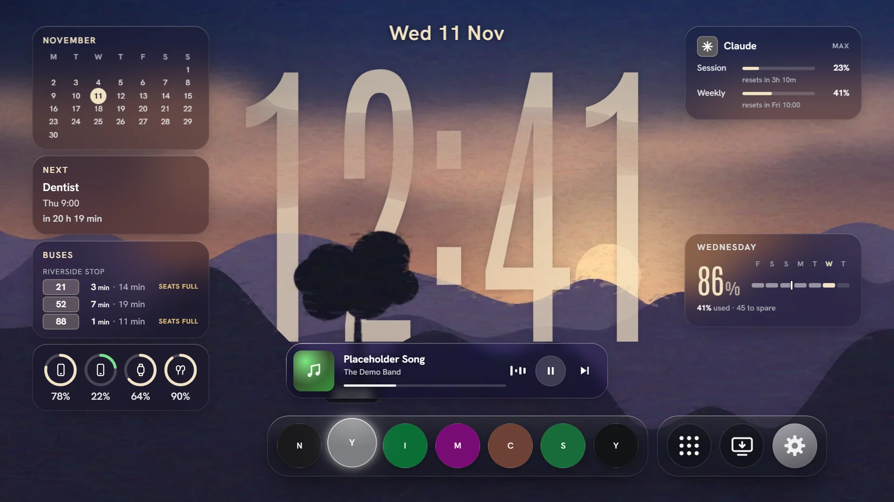
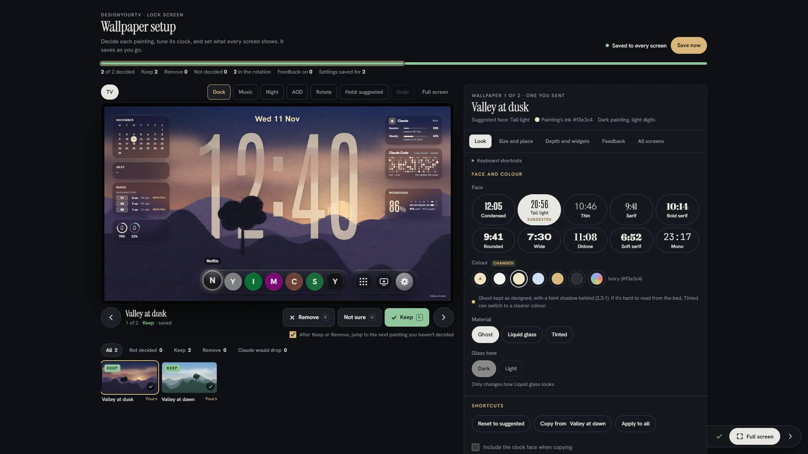
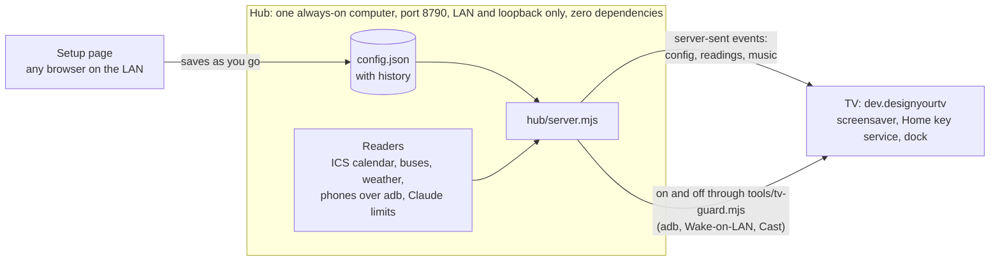

# designyourtv

**A screensaver for Google TV and Android TV.** Hills, clouds and jets pass in front of the digits, the way they do on an iPhone lock screen, and the widgets around it never fake a number.

[](https://github.com/Sohwhat6420/designyourtv/actions/workflows/test.yml)


<sub>Close up: the jet's nose and wing cross in front of the 4 and the 7.</sub>

- **The clock is a layer of the painting.** Each painting is cut into four layers once, on your own computer, by two
  small models (BiRefNet and Depth Anything V2), and the digits are drawn between the layers. When a foreground would
  hide more than 38 % of the digits, depth pauses for that painting.
- **Readings that admit their age.** Calendar, buses, batteries, weather, music and Claude limits. A stale reading greys
  out and says how old it is.
- **The remote stays in charge.** Any arrow raises a dock of apps; Home brings the painting back. Google TV stays the
  real Home underneath, so casting keeps working.

## Try it in 30 seconds, no TV needed

```bash
git clone https://github.com/Sohwhat6420/designyourtv && cd designyourtv
node hub/tools/demo.mjs
```

Then open <http://127.0.0.1:8790/tv-setup.html?kiosk=tv> and press an arrow key for the dock. Leave out `?kiosk=tv` for
the setup page. You need Node 22 and nothing else. The demo runs the real hub with sample readings and touches no adb,
no device and nothing on your machine; the page fetches its fonts from Google Fonts.

## What it looks like



Per painting you pick the clock's face (ten, from condensed to didone), its colour (or *auto*, sampled from the
painting), the material (ghost, liquid glass, tinted), size, stretch, position, and whether hours stack over minutes.
Changing painting is one 1.7 s move: a slow camera push, the digits cascading into the new face, the widgets stepping
back and returning in the new palette. Bring your own paintings with [the plate walkthrough](docs/make-a-plate.md).



Press any arrow and the dock rises: your apps on the left, the app drawer, the TV's inputs and settings on the right.
OK opens an app, fast-forward and rewind step through the paintings, and Home brings the painting back. On the
painting, OK is a night veil: one dark layer over everything with the backlight held low. After a quiet spell the TV
dims to an always-on look with the clock still live.




The setup page, open in any browser on your network, is where you decide what the TV shows. It saves as you go and the
TV follows as you save. The TV only ever shows the configuration; it never changes it.

<sub>Every screen above is the demo in headless Chromium at a TV panel's 1920 × 1080. App icons are not included (they
are the apps' own artwork), so the dock shows each app's letter until you add icons: see
[Configuration](#configuration).</sub>

## Put it on your TV

Tested on a Xiaomi Google TV (Android 11); the tools also know Google TV 14 and the older Android TV launcher. You need
[adb](https://developer.android.com/tools/releases/platform-tools), a JDK 17 and the Android SDK's build-tools and
`platforms;android-34` (Android Studio's SDK manager, or `sdkmanager`; set `ANDROID_HOME` if the SDK isn't in Android
Studio's default place). No Gradle. Every step below that changes the
TV is a dry run first, logged before it is sent, and undoable.

**1. Turn on debugging.** On the TV: *Settings > System > About*, press OK on *Android TV OS build* seven times, then
*Settings > System > Developer options > USB debugging*. Connect and accept the prompt on the TV:

```bash
adb connect <tv-ip>:5555
```

Whatever address `adb connect` accepted is your `--serial` from here on (newer Google TVs use another port: see
[If something is off](#if-something-is-off)).

**2. Start the hub** on a computer that stays on. Leave it running, note the line it prints, and use a second terminal
for the next steps:

```bash
mkdir -p hub/state && cp examples/config.example.json hub/state/config.json
node hub/server.mjs
# build the TV's APK with one of: --hub http://192.168.1.10:8790
```

**3. Build the TV app** with that address baked in. It runs the unit tests, signs the APK with a debug key it makes on
the first build, and checks the result:

```bash
JAVA_HOME=/path/to/jdk-17 node tools/build-tv-apk.mjs --hub http://192.168.1.10:8790
```

<details>
<summary>On Windows PowerShell, steps 2 and 3</summary>

```powershell
New-Item -ItemType Directory -Force hub/state | Out-Null; Copy-Item examples/config.example.json hub/state/config.json
node hub/server.mjs
# in a second window:
$env:JAVA_HOME = "C:\path\to\jdk-17"; node tools/build-tv-apk.mjs --hub http://192.168.1.10:8790
```
</details>

**4. Install it in one run.** Read the dry run, then add `--apply`:

```bash
node tools/tv-apply.mjs --serial <tv-ip>:<port> --tv-ip <tv-ip> --first-run
node tools/tv-apply.mjs --serial <tv-ip>:<port> --tv-ip <tv-ip> --first-run --apply
```

That installs the app with its two grants, lets the music card see what the TV is playing, and makes the painting the
screensaver, switched on. To see it now: *Settings > System > Ambient mode* (on older TVs, *Screen saver*) > *Start
now*. Otherwise it appears when the TV next goes idle.

**Optional: Home opens the painting.** This turns on the app's accessibility service alongside any you already have;
Google TV stays the real Home, and a long press of Home still opens its panel.

```bash
node tools/tv-apply.mjs --serial <tv-ip>:<port> --tv-ip <tv-ip> --home-key on --apply    # undo: --home-key off --apply
```

**Undo everything** with the log the run printed:

```bash
node tools/tv-apply.mjs --serial <tv-ip>:<port> --tv-ip <tv-ip> --undo devices/tv-undo-<date>.json --apply
```

### If something is off

| What you see | What to do |
| --- | --- |
| `TV GUARD refused ...: <app> is in front` | Press Home on the remote, then run it again. Installs are allowed over the home screen and TV Settings; anything that changes the screen waits until no app is playing. |
| `TV is Dreaming` or `TV is Asleep` | Press any button on the remote so the home screen shows, then run it again. |
| `could not read what is in front` | Check `adb devices` lists the TV as `device`, not `unauthorized`: accept the prompt on the TV. |
| `adb connect` fails | Newer Google TVs use *Wireless debugging*: turn it on in Developer options, run `adb pair <ip>:<port>` with the code it shows, then `adb connect` to the address it lists, and use that address as `--serial` (an IP and port, not the `adb-…-tls-connect` name adb may pick up by itself). |
| The clock and date on the built-in painting, but no widgets | That is the offline copy: the TV can't reach the hub. Allow Node.js through the firewall on private networks (Windows asks once), and check the APK was built with the address the hub printed. Give the hub computer a reserved address on your router so it never changes. |
| The painting never starts by itself | The TV's own idle timer decides: *Settings > System > Ambient mode > Start after* (or *Screen saver > When to start*). |
| `quiet hours: ...` | You set quiet hours (below). Run it outside them, or with `TV_GUARD_ALLOW_EVENING=1` for that one run. |

<details>
<summary><b>Quiet hours: keep the tools off the TV while people watch</b></summary>

There are none by default. Set them for your household, in the TV's local time zone:

```bash
TV_GUARD_QUIET_HOURS=18-1 TV_GUARD_TZ=Europe/London node tools/tv-apply.mjs ...
```

or put `{ "quiet_hours": "18-1", "tz": "Europe/London" }` in `devices/tv-guard.json`. Inside them anything that changes
the screen is refused; read-only commands still run. `node tools/tv-guard.mjs status` shows what is in force.
</details>

<details>
<summary><b>Debloat, reversibly</b></summary>

`tools/tv-debloat.json` sorts the TV's packages into tiers. Review the dry run, then add `--apply`:

```bash
node tools/tv-apply.mjs --serial <tv-ip>:<port> --tv-ip <tv-ip> --backup    # read-only snapshot first
node tools/tv-apply.mjs --serial <tv-ip>:<port> --tv-ip <tv-ip>             # the "safe" tier, dry run
```

It only ever disables (`pm disable-user`), never a full uninstall, never root, never a reboot. It refuses anything that
isn't a TV, the launcher, the setup wizard Google TV needs for casting, and anything serving an HDMI input or the tuner.
`--undo devices/tv-undo-<date>.json --apply`, with the same `--serial` and `--tv-ip`, reverses a run.
</details>

## How it works



The TV app is a small screensaver that shows the hub's page full screen; an offline copy shows whenever the hub doesn't
answer. The Claude limits widget runs a tiny headless `claude -p` probe on Haiku at most every 10 minutes (a negligible
share of your plan's limits). The bus widget reads Singapore's LTA DataMall; the other readers work
anywhere.

### Configuration

<details>
<summary><b>Files and variables</b></summary>

Everything personal lives in `hub/state/`, which git ignores:

| File | What it holds | Example |
| --- | --- | --- |
| `config.json` | the paintings' settings and the dock | [`examples/config.example.json`](examples/config.example.json) |
| `phones.json` | the phones the hub reads batteries from over adb (one may be marked for the watch and buds) | [`examples/phones.example.json`](examples/phones.example.json) |
| `bus.json` | your bus stops and services to leave out | [`examples/bus.example.json`](examples/bus.example.json) |
| `calendar.json` | your calendar's secret iCal address | [`hub/calendar.example.json`](hub/calendar.example.json) |
| `lta-datamall.key` | an [LTA DataMall](https://datamall.lta.gov.sg/) AccountKey, one line | |

| Variable | Default | |
| --- | --- | --- |
| `TV_HUB_PORT` | `8790` | the hub's port |
| `TV_SERIAL` | `192.168.1.20:5555` | the TV's adb address, for the hub's on/off and keep-alive |
| `TV_MAC`, `TV_BROADCAST` | none, `192.168.1.255` | the TV's Wi-Fi MAC and subnet broadcast, for Wake-on-LAN |
| `TV_WEATHER_AREA` | `City` | the NEA two-hour forecast area |
| `TV_PHONES_FILE`, `TV_BUS_FILE`, `TV_LTA_KEY_FILE` | `hub/state/…` | other places for those files |
| `TV_ADB` | `adb` | the adb the hub uses |
| `TV_TZ_OFFSET` | `8` | hours from UTC for the reminders' quiet hours (set yours) |
| `TV_CONTACT_URL` | none | your repo or a contact page, sent in the lyrics lookup's User-Agent |

App icons: put 192 px `.webp` files in `icons/tv/`, named after the app ids in `tv-setup.html`. Switch the TV on or off
from the hub with `node hub/tools/tv-power.mjs on|off|status` (adb, else Wake-on-LAN, else a Cast launch); `off` is
refused while another app is in front.
</details>

## Built on CleanYourTV's findings

[CleanYourTV](https://github.com/Gathin23/cleanyourtv) (MIT, by Gathin) is the backend reference: what is safe to
disable on a Google TV, and how a TV behaves once you do. What designyourtv took from it, rewritten for this app:

- **Home through an accessibility service, not a replacement launcher.** Android still handles Home, and a short press
  opens the painting a moment later.
- **Keep setupwraith on Google TV.** Disabling the setup wizard stops casting, and on Google TV 14 a Home that falls
  back to its RecoveryActivity soft-reboots the TV every minute or so. `tv-apply.mjs` refuses both orders of that
  mistake.
- **Start the painting like an app,** so launcherx keeps the Home role and the remote's own app buttons keep working.
- **The boot window event that never comes.** At boot the launcher is often on screen before the service binds, so the
  service reads the usage log for what is in front instead.
- **Guards before disabling anything,** following CleanYourTV's `tools/disable.sh`.

Want the same look on a Windows desktop? That is [designyourwindows](https://github.com/Sohwhat6420/designyourwindows).

## Tests

```bash
node --test hub/test/*.test.mjs                      # the hub: config, SSE, net guard, readers, TV power, static files
node --test tools/test/*.test.mjs                    # tv-guard, and a first run against a fake TV over a fake adb
node tools/tv-apply.mjs --selftest                   # tv-apply against an in-process fake TV, undo round trips included
JAVA_HOME=/path/to/jdk-17 node tools/build-tv-apk.mjs --test-only   # the APK's core logic on a plain JVM
```

## Privacy and safety

- The hub answers only LAN and loopback addresses, checks the Host header against DNS rebinding, and never serves
  `hub/state/`, keys or logs. API keys and calendar addresses are cut out of every log line and error.
- `tv-apply.mjs` only makes changes it can undo, logs each one before sending it, works on one explicit serial, and
  refuses anything that isn't a TV, so a phone on the same adb server is never touched.
- The repository was swept for secrets and personal data before publishing: [docs/security-sweep.md](docs/security-sweep.md).

## Credits

The two F-22 paintings in `plates/` and the screenshots are oil-paint repaints, made with an image model, of
public-domain U.S. Air Force photos on Wikimedia Commons:
[F-22 Raptors over Alaska](https://commons.wikimedia.org/wiki/File:F-22_Raptor_pair_over_Alaska_-_081010-F-1234X-924.jpg)
and [F-22 Raptor flying at twilight](https://commons.wikimedia.org/wiki/File:F-22_Raptor_flying_at_twilight_190728-F-VA182-1014.jpg)
(U.S. Air Force photo by 2nd Lt. Samuel Eckholm). No endorsement by the U.S. Air Force is implied. The demo's music
card names Debussy's *Clair de lune*, a public-domain work, as sample data.

## Licence

[MIT](LICENSE). Not included and not covered by it: the paintings you bring, the apps' icons, the ONNX models (BiRefNet
is MIT, Depth Anything V2 Small is Apache 2.0; both are downloaded separately), and the fonts, which load from Google
Fonts under the SIL Open Font Licence.
