# designyourtv

**An Android TV home screen: an oil painting, a clock behind its subject, live widgets.**

It was built for a slow television. With nothing moving it drew **0 frames in 10 seconds** on a Xiaomi TV with
1,788 MB of RAM (Android 11, 4 Nov 2026): [how it was measured](docs/numbers.md#on-the-television). No TV to hand?
[Try it in a browser in 30 seconds](#try-it-in-30-seconds-without-a-tv).

[](https://github.com/Sohwhat6420/designyourtv/actions/workflows/test.yml)


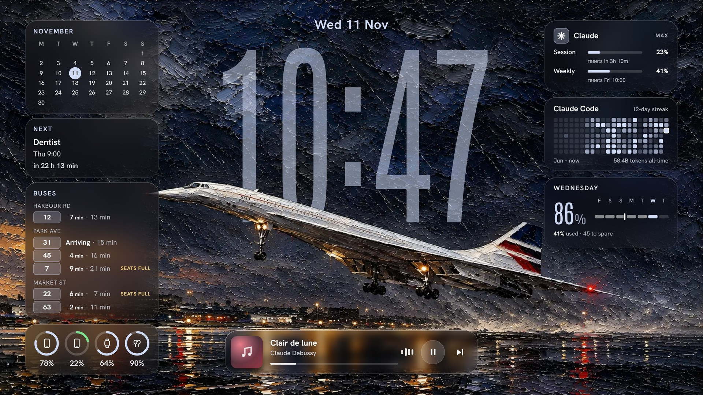

<sub>The home screen at rest, captured from the page itself at 1920 × 1080. Rain is in the forecast, so it rains in the
painting. The bus stops and services are made up, the Claude Code card shows the author's own activity, and the other
readings are the demo's samples.</sub>

## What it costs the television

A wallpaper on a television with 1,788 MB of RAM has to earn its place, so the rule was simple: when nothing on the
screen is changing, the TV should be doing nothing. Everything in this section was measured on one television (a
Xiaomi set on Android 11 with four cores, which Android itself flags as low-RAM) on the dates shown.
[Method, raw readings and caveats](docs/numbers.md#on-the-television).

<picture>
  <source media="(prefers-color-scheme: dark)" srcset="assets/premium/idle-dark.svg">
  
</picture>

<sub>Left: a cap in the page's code, not a measured frame rate. The rain is the only thing that moves continuously,
and it is stepped 24 times a second. Middle and right: measured on the television.</sub>

It is not free while it shows. On screen it cost about 170 MB of the TV's memory, and 70 MB of the app's own share
was the painting, held as graphics textures (3 Nov 2026). Leave it for another app and its scripts stop; with an HDMI
input in front it held 5.8 MB (3 Nov 2026). A later build let that slip behind streaming apps and was fixed in code,
with no saved reading after the fix: [the method page](docs/numbers.md#on-the-television) says exactly what is and is
not known.

The same television also shows what one round of fixes bought. Each row is one action, before and after:

<picture>
  <source media="(prefers-color-scheme: dark)" srcset="assets/premium/before-after-dark.svg">
  
</picture>

<sub>One Xiaomi television, Android 11, 1,788 MB of RAM, 4 Nov 2026, panel dark.</sub>

| What was slow | Before | After | What changed |
| :--- | ---: | ---: | :--- |
| Changing the painting: how long the page froze | 943 to 1,318 ms | 18 to 25 ms | The clock's mask is read from a 192 × 108 copy made ahead of time, not from two full-size pictures |
| Dock sliding by day: typical frame | 85 ms | 25 ms | The glass shows a copy of the painting that was blurred ahead of time, instead of blurring it live |
| Dock sliding at night: slowest frame | 282 ms | 37 to 41 ms | The same |
| App drawer opening: typical frame | 57 ms | 23 ms | The same |
| Opening Netflix from the dock: press to hand-over, app already loaded | 389 ms | 231 ms | The dock hands over 160 ms sooner, as soon as its colour fill covers the screen |
| Accessibility bookkeeping on each painting change | 133 to 151 ms | 0 ms | The embedded browser no longer builds an accessibility tree for the wallpaper |

25 ms is also what this TV takes to draw a frame of the dock with every blur and shadow stripped out, so the frosted
dock now costs about the same as a bare one.

Two things these numbers do not say. The frame times were taken with the panel dark, where this TV paces its frames
differently, so read them as before against after and not as a smoothness score. And nothing here was measured like
for like against Google TV's own home screen, so this page makes no claim about it.

<details>
<summary>The same page in a desktop browser (14 Nov 2026, not a TV)</summary>

| Figure | What it counts |
| ---: | :--- |
| **0.5&nbsp;%** | of the page's main thread busy at rest, with a song playing |
| **2.6 to 2.8&nbsp;MB** | of JavaScript heap at rest, in two runs |
| **1.0&nbsp;MB** | for a first load: the page, the paintings and their cut-outs, and the fonts |
| **0** | npm dependencies: the hub and every tool use only Node's built-in modules |
| **164** | tests in CI, plus 111 checks of the APK's core logic in every build |

Headless Chromium on a 4-core cloud machine with no GPU. Method and raw results:
[docs/numbers.md](docs/numbers.md#in-a-desktop-browser).
</details>

## When nobody is watching

Always-on display (AOD) mode treats an idle television as a picture on a wall, not a lit screen.

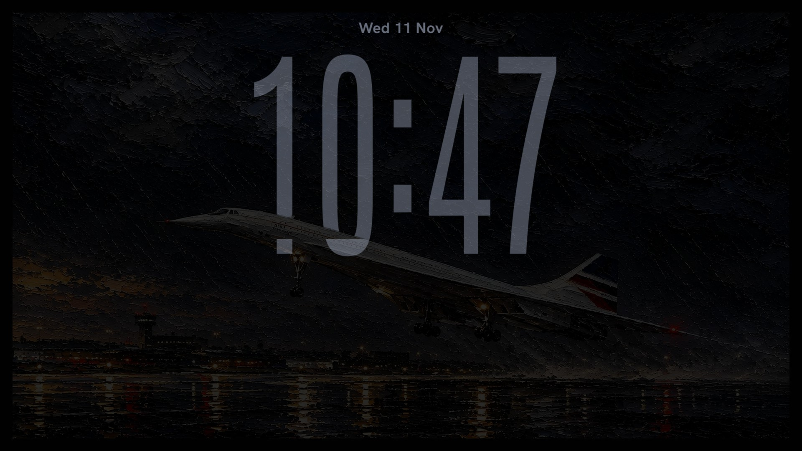

<sub>AOD mode, captured from the page: a matte, the painting under a veil, one dim clock, and 0 running animations.
<a href="assets/premium/aod.webp">Watch it come down and wake again (9 s)</a>.</sub>

<picture>
  <source media="(prefers-color-scheme: dark)" srcset="assets/premium/aod-timeline-dark.svg">
  
</picture>

<sub>Timings from the page's code; time is not drawn to scale. The inset is the clock's real path over three hours.</sub>

It arms after 30 minutes without a key press, or after 2 minutes between 23:00 and 07:00. The widgets and the dock
leave, the backlight drops to 1 of the panel's 100 (a setting, from 1 to 35), and every animation stops. The one thing
left is a dim clock, and it does not sit still: every 4 minutes it steps to the next point on a slow path, with no
motion in between, the kind of guard television makers build in against burn-in. Between midnight and 07:00, after
3 hours idle and with nothing playing, the panel itself goes dark. Any key wakes it, and that key does nothing else,
so a press in the dark never opens something by accident. It comes back faster (1.1 s) than it went (2.6 s).

What this saves in watts was never measured (there was no meter on the plug), and neither was the effect on burn-in,
so this page gives the backlight levels and the mechanisms and stops there.

## Design decisions, and the reason for each

### The clock stands behind the subject, until that would cost you the time


The digits are a layer inside the painting: the aircraft passes in front of them and the rain falls over both. A
clock still has to be readable from across a room, so before drawing it the page measures how much of the digits the
subject would hide, and above 38 % it gives up depth for that painting. Contrast is checked against the worst part of
the picture behind the digits, not the average, with a target of 4:1; if a painting cannot reach it, the digits are
drawn solid with a halo. The date sits above the subject, so nothing can ever cover it.

### Glass that takes its colour from the painting

<table>
<tr>
<td width="50%" valign="top">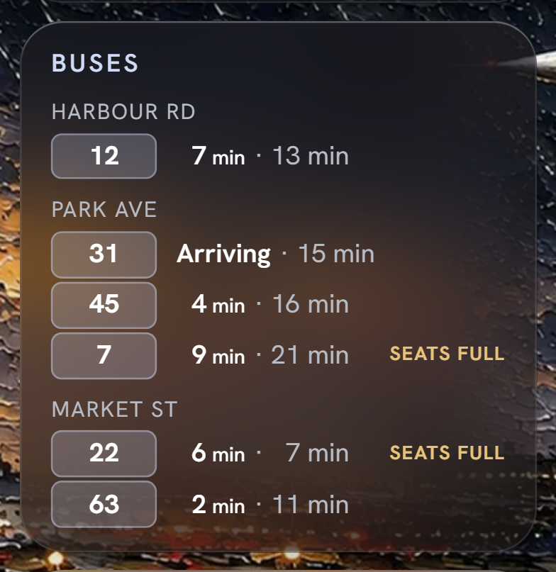</td>
<td width="50%" valign="top">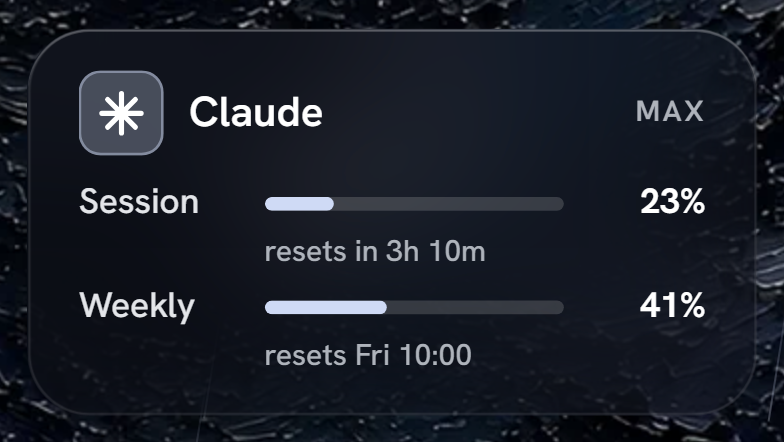</td>
</tr>
</table>

Both cards are from the same frame. The bus card is warm because it sits over the runway lights; the Claude card is
navy because it sits over the sky. The glass is sampled from the painting where the widgets stand, with its saturation
capped, and then thickened step by step until white text reaches 4.5:1 against the brightest part behind each card.
Secondary text is an opaque grey and not white at 60 %, because translucent white picks up the painting and loses
contrast.

### Readings that say how old they are

A bus row greys out after three minutes without fresh data and its label gains "as of" and the time it was read.
Batteries, Claude limits and the weather dim the same way. On a television a card stays hidden until its first real
reading arrives (30 seconds at most), so it never flashes a sample number. A wrong figure on the wall is worse than
none.

### A dock that comes when called


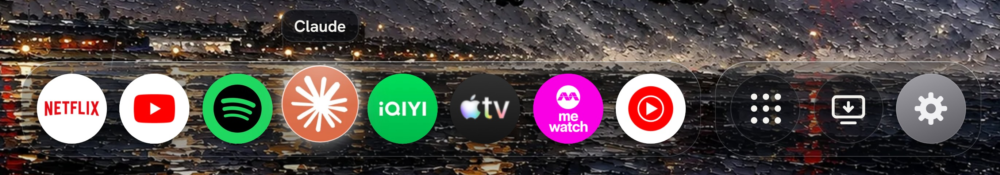

At rest the painting is all there is. Any arrow on the remote raises the dock: your apps on one island, the app
drawer, the TV's inputs and settings on the other. It sits to the right of the widgets and never over them, and it
leaves on Back, on Up, or after a minute. Opening an app fills the screen with the icon's strongest colour, taken
deep, so a white or neon icon never flashes a dark room. The icons are the apps' own artwork and are not in the
repository: you add your own ([Configuration](#configuration)), and until then each tile shows the app's initial.

### Night on OK: one veil over everything

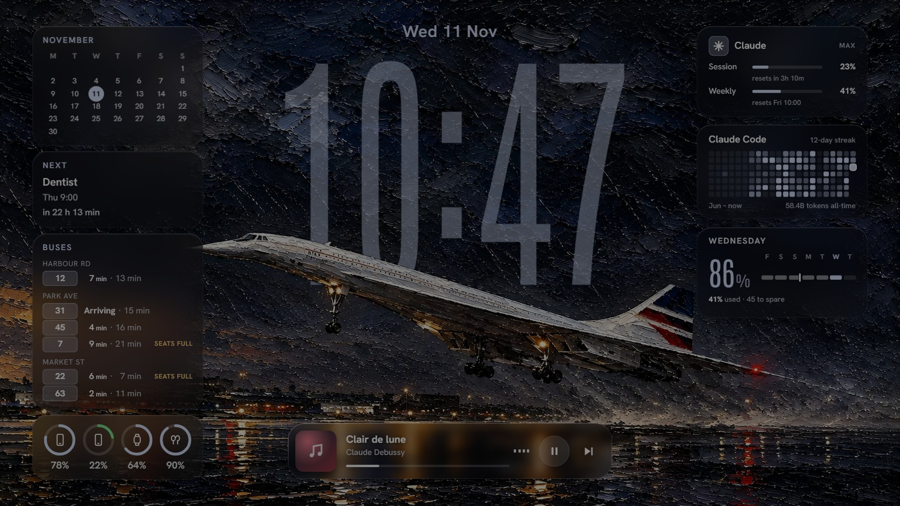

On the painting, OK dims the whole screen at once and holds the backlight low; OK again, or any other key, brings it
back. An earlier version used two veils and dimmed the widgets less than the painting, so they stood out in a dark
room. Now one veil covers the painting, the clock and the widgets at the same level, so everything stays readable and
nothing shines. Nothing animates while it is on.

<br clear="right">

### Weather is not a card

When the forecast says rain, the page draws rain into the painting. It is off in AOD mode, under the night veil, and
for anyone who has asked their device for reduced motion.

### It shares the television

Google TV stays the real launcher underneath, so casting and the remote's own app buttons keep working; Home brings
the painting back. During development a measuring script once pressed Home and stopped YouTube while someone was
watching. Since then every tool goes through [`tools/tv-guard.mjs`](tools/tv-guard.mjs): nothing that changes the
screen runs unless the painting or a home screen is in front, it refuses to force-stop other apps, and a household can
set [quiet hours](#if-something-is-off).

## The widgets

<table>
<tr>
<td width="50%" valign="top">

<br>
<b>Buses.</b> Three stops and six services at once, each with its next two arrivals, read from the DataMall of Singapore's
Land Transport Authority (LTA) and smoothed so a bus does not drop out of the list for one bad reading. The stops and services in this
picture are made up.
</td>
<td width="50%" valign="top">
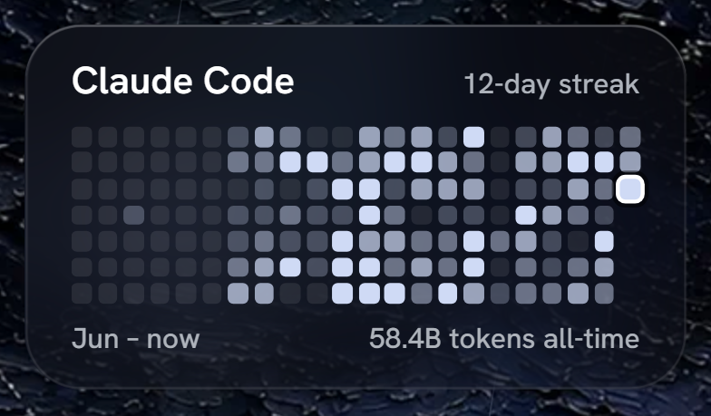
<br>
<b>Claude Code.</b> Daily activity (here from June), the current streak and an all-time token count, read from Claude
Code's own transcripts on the hub's computer. Its squares take the clock's colour, so it changes with the painting.
Until the hub has activity to show, the card labels itself a sample.
<br><br>

<br>
<b>Claude limits.</b> Session and weekly use of a Claude plan, from a small headless probe at most every 10 minutes.
</td>
</tr>
</table>

<table>
<tr>
<td width="25%" valign="top">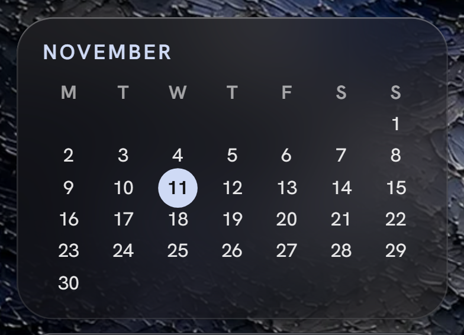<br><b>Calendar.</b> The month, with today ringed.</td>
<td width="25%" valign="top">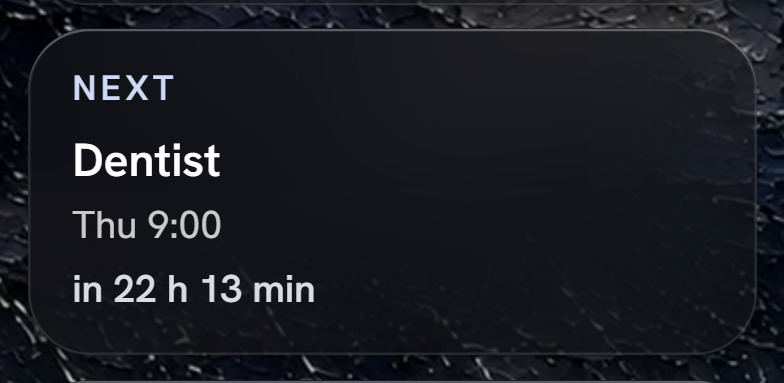<br><b>Next.</b> The next event from any calendar feed (ICS), counting down.</td>
<td width="25%" valign="top">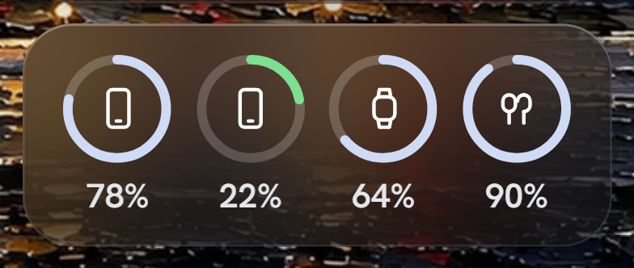<br><b>Batteries.</b> Phone, tablet, watch and earbuds, read over adb.</td>
<td width="25%" valign="top">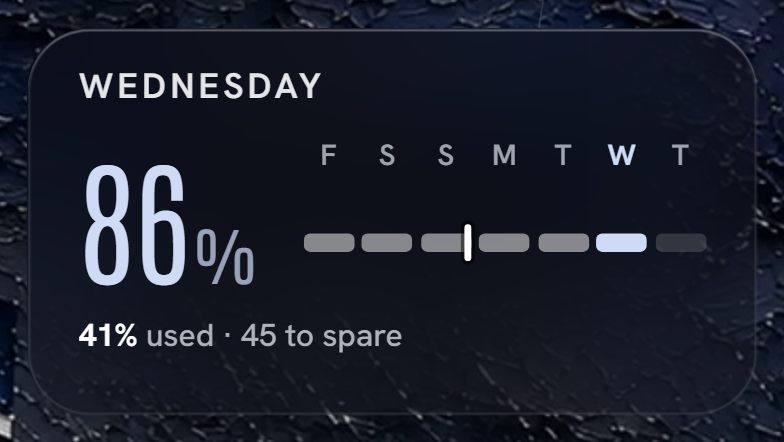<br><b>Pace.</b> What today allows of the weekly limit against what is used.</td>
</tr>
</table>

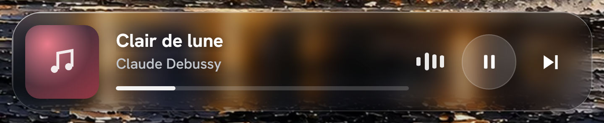

The music card follows whatever the TV itself is playing, with pause and skip.

## Try it in 30 seconds, without a TV

You need Node 22 and nothing else.

```bash
git clone https://github.com/Sohwhat6420/designyourtv
```

```bash
node designyourtv/hub/tools/demo.mjs
```

It prints where to look:

```console
designyourtv demo on http://127.0.0.1:8790/tv-setup.html?kiosk=tv  (setup: http://127.0.0.1:8790/tv-setup.html)
```

Open the first address and press an arrow key for the dock. The second is the setup page. The demo runs the real hub
with sample readings and touches no adb, no device and nothing on your machine; the page fetches its fonts from
Google Fonts. It opens on the sample paintings that ship with the repository, with one bus stop and lettered dock
tiles, not on the author's set shown above.


Every painting keeps its own clock. Per painting you pick the face (ten, from condensed to didone), its colour (or
*auto*, sampled from the painting), the material (ghost, liquid glass, tinted), size, stretch, position, and whether
hours stack over minutes. Bring your own paintings with [the plate walkthrough](docs/make-a-plate.md).

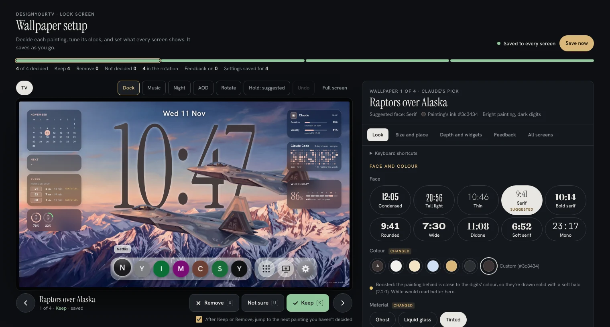

The setup page, open in any browser on your network, is where you decide what the TV shows. It saves as you go and the
TV follows as you save. The TV only ever shows the configuration; it never changes it.

## Small things that make it livable

- **Night on OK.** On the painting, OK drops one dark veil over everything and holds the backlight low; the widgets
  stay readable and nothing animates.
- **Always-on display.** After a quiet spell the TV dims to a matte, a veiled painting and one dim clock.
- **Per-app brightness.** Music apps sit at a mid backlight (70 of 100), films keep yours, and a screen-off button in
  the dock turns the panel dark while the music plays on.
- **Fast opens.** The page's scripts pause whenever another app is in front, so the TV spends nothing on a wallpaper
  nobody can see.
- **A way back to Google TV.** Home on the painting goes to Google TV for ten minutes; a long press of Home still
  opens its panel.
- **The remote steps through paintings.** Fast-forward and rewind (or channel up and down) move to the next and the
  last.

## How it works

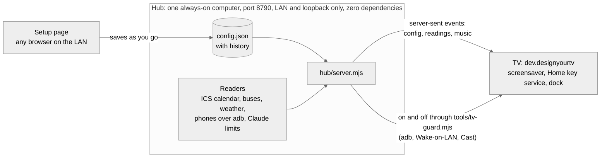

The TV app is a small screensaver that shows the hub's page full screen; an offline copy shows whenever the hub doesn't
answer. The Claude limits widget runs a tiny headless `claude -p` probe on Haiku at most every 10 minutes (one short
call each time). The bus widget reads Singapore's LTA DataMall; the other readers work anywhere.

### How the depth works

Each painting is cut once, on your computer's CPU, by two ONNX models: BiRefNet (general, lite) finds the subject and
Depth Anything V2 Small finds what is nearer than the sky. `tools/depth_pipeline.py` turns them into three cut-outs
(the ground, the ground with near clouds, the subject alone), and the page draws the clock between the painting and
the cut-out you pick. Before it does, it measures how much of the digits that cut-out would hide; above 38 % it pauses
depth for that painting rather than make the time hard to read. [Make your own plate](docs/make-a-plate.md).

## Put it on your TV

Tested on one television, a Xiaomi Google TV on Android 11. The tools also know Google TV 14 and the older Android TV
launcher, but those were not tried on a set. You need [adb](https://developer.android.com/tools/releases/platform-tools),
a JDK 17 and the Android SDK's build-tools and `platforms;android-34` (Android Studio's SDK manager, or `sdkmanager`;
set `ANDROID_HOME` if the SDK isn't in Android Studio's default place). No Gradle. Every step below that changes the
TV is a dry run first, logged before it is sent, and undoable.

**1. Turn on debugging.** On the TV: *Settings > System > About*, press OK on *Android TV OS build* seven times, then
*Settings > System > Developer options > USB debugging*. Connect and accept the prompt on the TV:

```bash
adb connect <tv-ip>:5555
```

Whatever address `adb connect` accepted is your `--serial` from here on (newer Google TVs use another port: see
[If something is off](#if-something-is-off)).

**2. Start the hub** on a computer that stays on. Make its state folder and copy the example configuration in:

```bash
mkdir -p hub/state
```

```bash
cp examples/config.example.json hub/state/config.json
```

```bash
node hub/server.mjs
```

Leave it running and note the line it prints: it names the `--hub` address to build the TV's app with, for example
`--hub http://192.168.1.10:8790`. Use a second terminal for the next steps.

**3. Build the TV app** with that address baked in. It runs the unit tests, signs the APK with a debug key it makes on
the first build, and checks the result:

```bash
JAVA_HOME=/path/to/jdk-17 node tools/build-tv-apk.mjs --hub http://192.168.1.10:8790
```

<details>
<summary>On Windows PowerShell, steps 2 and 3</summary>

```powershell
New-Item -ItemType Directory -Force hub/state | Out-Null
```

```powershell
Copy-Item examples/config.example.json hub/state/config.json
```

```powershell
node hub/server.mjs
```

In a second window:

```powershell
$env:JAVA_HOME = "C:\path\to\jdk-17"; node tools/build-tv-apk.mjs --hub http://192.168.1.10:8790
```
</details>

**4. Install it in one run.** Read the dry run:

```bash
node tools/tv-apply.mjs --serial <tv-ip>:<port> --tv-ip <tv-ip> --first-run
```

Then run it for real:

```bash
node tools/tv-apply.mjs --serial <tv-ip>:<port> --tv-ip <tv-ip> --first-run --apply
```

That installs the app with its two grants, lets the music card see what the TV is playing, and makes the painting the
screensaver, switched on. To see it now: *Settings > System > Ambient mode* (on older TVs, *Screen saver*) > *Start
now*. Otherwise it appears when the TV next goes idle.

**Optional: Home opens the painting.** This turns on the app's accessibility service alongside any you already have;
Google TV stays the real Home, and a long press of Home still opens its panel.

```bash
node tools/tv-apply.mjs --serial <tv-ip>:<port> --tv-ip <tv-ip> --home-key on --apply
```

To undo it:

```bash
node tools/tv-apply.mjs --serial <tv-ip>:<port> --tv-ip <tv-ip> --home-key off --apply
```

**Undo everything** with the log the run printed:

```bash
node tools/tv-apply.mjs --serial <tv-ip>:<port> --tv-ip <tv-ip> --undo devices/tv-undo-<date>.json --apply
```

### If something is off

| What you see | What to do |
| --- | --- |
| `TV GUARD refused ...: <app> is in front` | Press Home on the remote, then run it again. Installs are allowed over the home screen and TV Settings; anything that changes the screen waits until no app is playing. |
| `TV is Dreaming` or `TV is Asleep` | Press any button on the remote so the home screen shows, then run it again. |
| `could not read what is in front` | Check `adb devices` lists the TV as `device`, not `unauthorized`: accept the prompt on the TV. |
| `adb connect` fails | Newer Google TVs use *Wireless debugging*: turn it on in Developer options, run `adb pair <ip>:<port>` with the code it shows, then `adb connect` to the address it lists, and use that address as `--serial` (an IP and port, not the `adb-…-tls-connect` name adb may pick up by itself). |
| The clock and date on the built-in painting, but no widgets | That is the offline copy: the TV can't reach the hub. Allow Node.js through the firewall on private networks (Windows asks once), and check the APK was built with the address the hub printed. Give the hub computer a reserved address on your router so it never changes. |
| The painting never starts by itself | The TV's own idle timer decides: *Settings > System > Ambient mode > Start after* (or *Screen saver > When to start*). |
| `quiet hours: ...` | You set quiet hours (below). Run it outside them, or with `TV_GUARD_ALLOW_EVENING=1` for that one run. |

<details>
<summary><b>Quiet hours: keep the tools off the TV while people watch</b></summary>

There are none by default. Set them for your household, in the TV's local time zone:

```bash
TV_GUARD_QUIET_HOURS=18-1 TV_GUARD_TZ=Europe/London node tools/tv-apply.mjs ...
```

or put `{ "quiet_hours": "18-1", "tz": "Europe/London" }` in `devices/tv-guard.json`. Inside them anything that changes
the screen is refused; read-only commands still run. `node tools/tv-guard.mjs status` shows what is in force.
</details>

<details>
<summary><b>Debloat, reversibly</b></summary>

`tools/tv-debloat.json` sorts the TV's packages into tiers. Take a read-only snapshot first:

```bash
node tools/tv-apply.mjs --serial <tv-ip>:<port> --tv-ip <tv-ip> --backup
```

Then review the dry run of the "safe" tier, and add `--apply` when you are happy with it:

```bash
node tools/tv-apply.mjs --serial <tv-ip>:<port> --tv-ip <tv-ip>
```

It only ever disables (`pm disable-user`), never a full uninstall, never root, never a reboot. It refuses anything that
isn't a TV, the launcher, the setup wizard Google TV needs for casting, and anything serving an HDMI input or the tuner.
`--undo devices/tv-undo-<date>.json --apply`, with the same `--serial` and `--tv-ip`, reverses a run. Expect a tidier
TV, not a faster one: on the television above the safe tier freed 69 MB (3 Nov 2026), because most preinstalled extras
were not running in the first place.
</details>

### Configuration

<details>
<summary><b>Files and variables</b></summary>

Everything personal lives in `hub/state/`, which git ignores:

| File | What it holds | Example |
| --- | --- | --- |
| `config.json` | the paintings' settings and the dock | [`examples/config.example.json`](examples/config.example.json) |
| `phones.json` | the phones the hub reads batteries from over adb (one may be marked for the watch and buds) | [`examples/phones.example.json`](examples/phones.example.json) |
| `bus.json` | your bus stops and services to leave out | [`examples/bus.example.json`](examples/bus.example.json) |
| `calendar.json` | your calendar's secret iCal address | [`hub/calendar.example.json`](hub/calendar.example.json) |
| `lta-datamall.key` | an [LTA DataMall](https://datamall.lta.gov.sg/) AccountKey, one line | |

| Variable | Default | |
| --- | --- | --- |
| `TV_HUB_PORT` | `8790` | the hub's port |
| `TV_SERIAL` | `192.168.1.20:5555` | the TV's adb address, for the hub's on/off and keep-alive |
| `TV_MAC`, `TV_BROADCAST` | none, `192.168.1.255` | the TV's Wi-Fi MAC and subnet broadcast, for Wake-on-LAN |
| `TV_WEATHER_AREA` | `City` | the two-hour forecast area of Singapore's National Environment Agency (NEA) |
| `TV_PHONES_FILE`, `TV_BUS_FILE`, `TV_LTA_KEY_FILE` | `hub/state/…` | other places for those files |
| `TV_ADB` | `adb` | the adb the hub uses |
| `TV_TZ_OFFSET` | `8` | hours from UTC for the reminders' quiet hours (set yours) |
| `TV_CONTACT_URL` | none | your repo or a contact page, sent in the lyrics lookup's User-Agent |

App icons: put 192 px `.webp` files in `icons/tv/`, named after the app ids in `tv-setup.html`. Switch the TV on or off
from the hub with `node hub/tools/tv-power.mjs on|off|status` (adb, else Wake-on-LAN, else a Cast launch); `off` is
refused while another app is in front.
</details>

## Built on CleanYourTV's findings

[CleanYourTV](https://github.com/Gathin23/cleanyourtv) (MIT, by Gathin) is the backend reference: what is safe to
disable on a Google TV, and how a TV behaves once you do. What designyourtv took from it, rewritten for this app:

- **Home through an accessibility service, not a replacement launcher.** Android still handles Home, and a short press
  opens the painting a moment later.
- **Keep setupwraith on Google TV.** Disabling the setup wizard stops casting, and on Google TV 14 a Home that falls
  back to its RecoveryActivity soft-reboots the TV every minute or so. `tv-apply.mjs` refuses both orders of that
  mistake.
- **Start the painting like an app,** so launcherx keeps the Home role and the remote's own app buttons keep working.
- **The boot window event that never comes.** At boot the launcher is often on screen before the service binds, so the
  service reads the usage log for what is in front instead.
- **Guards before disabling anything,** following CleanYourTV's `tools/disable.sh`.

Want the same look on a Windows desktop? That is [designyourwindows](https://github.com/Sohwhat6420/designyourwindows).

## Tests

The hub: config, server-sent events, the network guard, readers, TV power and static files.

```bash
node --test hub/test/*.test.mjs
```

tv-guard, and a first run against a fake TV over a fake adb:

```bash
node --test tools/test/*.test.mjs
```

tv-apply against an in-process fake TV, undo round trips included:

```bash
node tools/tv-apply.mjs --selftest
```

The APK's core logic on a plain JVM:

```bash
JAVA_HOME=/path/to/jdk-17 node tools/build-tv-apk.mjs --test-only
```

That is 125, 31 and 8 tests in CI, and 111 checks of the core logic in every APK build.

## Privacy and safety

- The hub answers only LAN and loopback addresses, checks the Host header against DNS rebinding, and never serves
  `hub/state/`, keys or logs. API keys and calendar addresses are cut out of every log line and error.
- `tv-apply.mjs` only makes changes it can undo, logs each one before sending it, works on one explicit serial, and
  refuses anything that isn't a TV, so a phone on the same adb server is never touched.
- **There is no login.** Anyone on your network can read the hub and change its settings. Its readings (the next
  calendar event, batteries, bus times, Claude use) are served to any origin, so a web page open in a browser on your
  network may be able to read them, subject to the browser's own private-network protections; only pages served from
  your network can write. Run it on a home network you trust.
- The repository was swept for secrets and personal data before publishing: [docs/security-sweep.md](docs/security-sweep.md).

## Credits

The paintings in this page's pictures are the author's own set and are not included in the repository: bring your own
with [the plate walkthrough](docs/make-a-plate.md), or start from the sample paintings the repository ships.

Those samples, the two F-22 paintings in `plates/`, are oil-paint repaints, made with an image model, of public-domain
U.S. Air Force photos on Wikimedia Commons:
[F-22 Raptors over Alaska](https://commons.wikimedia.org/wiki/File:F-22_Raptor_pair_over_Alaska_-_081010-F-1234X-924.jpg)
and [F-22 Raptor flying at twilight](https://commons.wikimedia.org/wiki/File:F-22_Raptor_flying_at_twilight_190728-F-VA182-1014.jpg)
(U.S. Air Force photo by 2nd Lt. Samuel Eckholm). No endorsement by the U.S. Air Force is implied. The demo's music
card names Debussy's *Clair de lune*, a public-domain work, as sample data. The two valley paintings are drawn by
`tools/make-placeholder.py`. Every screen in this README is a capture of the real page, and the three drawn panels
are built by `tools/readme-media/panels.py` ([how it was made](docs/numbers.md#how-the-media-is-made)). The panels and banners are set
in Hanken Grotesk, Instrument Serif and JetBrains Mono (SIL OFL 1.1, in `tools/readme-media/fonts/`). The dock's icons in the pictures belong to their
apps' owners.

## Licence

[MIT](LICENSE). Not included and not covered by it: the paintings you bring, the apps' icons, the ONNX models (BiRefNet
is MIT, Depth Anything V2 Small is Apache 2.0; both are downloaded separately), and the fonts, which load from Google
Fonts under the SIL Open Font Licence.

A one-person project, tested on one television. Bugs and questions: [open an issue](https://github.com/Sohwhat6420/designyourtv/issues).
