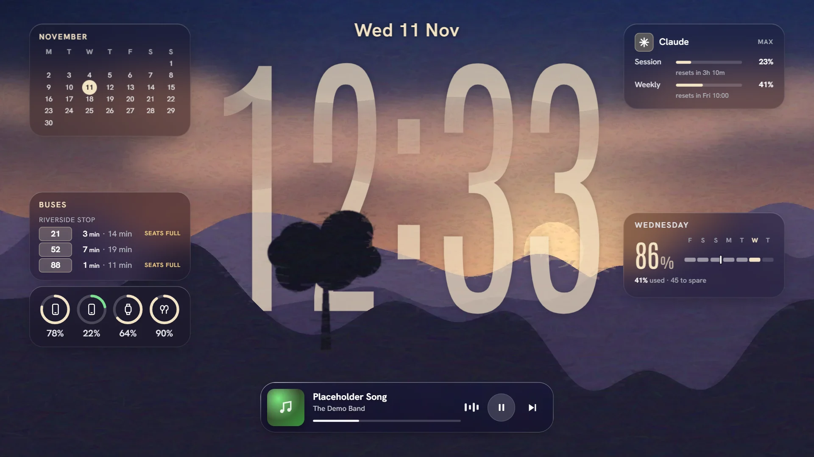
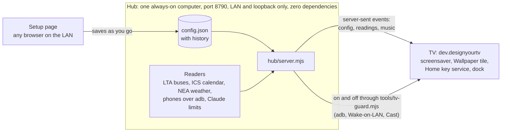

# designyourtv

**Your Google TV's idle screen becomes a painted lock screen, with the clock standing behind the painting.**

[](https://github.com/Sohwhat6420/designyourtv/actions/workflows/test.yml)




<sub>The repo's own demo with sample readings, at the TV panel's 1920 × 1080. The painting is an oil-paint repaint,
made with an image model, of a public-domain U.S. Air Force photo (<a href="#credits">credits</a>).</sub>

- **The clock sits inside the painting.** Each painting is cut into layers once, on your own computer, by two small ONNX models. The
  clock is drawn between the layers, and depth pauses whenever a foreground would hide more than 38 % of the digits.
- **Widgets that never fake a number.** They show the calendar, live buses, batteries, Claude limits, the weather and
  music, and a stale reading greys out and says how old it is.
- **The remote stays in charge.** Any arrow raises a dock of apps; Home brings the painting back. The TV side builds
  on CleanYourTV's findings, so casting keeps working.

## Quick start (no TV needed)

```bash
git clone https://github.com/Sohwhat6420/designyourtv && cd designyourtv
node hub/tools/demo.mjs   # Node 22; then open http://127.0.0.1:8790/tv-setup.html?kiosk=tv
```

The demo runs the real hub with sample readings. It touches no adb, no device and nothing on your machine; the page
fetches its fonts from Google Fonts. Press an
arrow key for the dock, or open `tv-setup.html` without `?kiosk=tv` for the setup page.

It is the frontend half of a TV clean-up. The backend half (what is safe to switch off on a Google TV, how to keep
casting working, how to take over the Home button without replacing the launcher) builds on
[CleanYourTV](https://github.com/Gathin23/cleanyourtv): see [Built on CleanYourTV's findings](#built-on-cleanyourtvs-findings).
Want the same look on a Windows desktop? That is [designyourwindows](https://github.com/Sohwhat6420/designyourwindows),
kept separate and deliberately small.

## How it works



The TV only ever shows the configuration; it never changes it. An offline copy of the page shows whenever the hub
doesn't answer. The Claude limits widget runs a tiny headless `claude -p` probe on Haiku at most every 10 minutes
(about USD0.0002 of your subscription each time).

## What it looks like

### Depth-clock paintings


Each painting is four layers: the painting, a foreground cut-out, the same plus near clouds, and the subject alone.
The clock is drawn between them, so hills, trees and clouds pass in front of the digits the way they do on an iPhone
lock screen. The cut-outs come from two small ONNX models run once on your own computer
([make your own plate](docs/make-a-plate.md)). The page guards legibility: when a foreground would hide more than
38 % of the digits, depth pauses for that painting unless you say otherwise.

Per painting you pick the face (ten, from condensed to didone), the colour (or *auto*, sampled from the painting),
the material (ghost, liquid glass, tinted), size, stretch, width, where the clock sits, and whether hours stack over
minutes. Changing painting is a single 1.7 s move: a slow camera push, the digits cascading into the new face,
the widgets stepping back and returning in the new palette.

### Glass widgets

A calendar month, the next event from any ICS feed, live bus arrivals (Singapore's LTA DataMall, smoothed so a bus
doesn't flicker out of the list for one bad reading), phone, watch and earbud batteries as iPadOS-style rings, Claude
plan limits, the weather, and a Dynamic Island-style music card that follows what the TV itself is playing. Every
reading greys out and says how old it is once it goes stale, and nothing ever shows a made-up "0%" for a reading it
doesn't have.

### A dock you drive with the remote


Press any arrow and the dock rises: two islands of glass, your apps on the left and the full app drawer, the TV's
inputs and settings on the right. OK opens the app. Fast-forward and rewind step through the paintings. Home brings
the painting back; Home on the painting goes to Google TV for ten minutes.

Small things that make it livable:

- **Night on OK.** On the painting, OK drops one dark veil over everything and holds the panel's backlight low; the
  widgets stay readable, nothing animates.
- **Ambient (AOD).** After a quiet spell the TV dims to an always-on look with the clock and widgets still live.
- **Per-app brightness.** Music apps sit at a mid backlight, films keep yours, and a screen-off button in the dock
  turns the panel dark while the music plays on.
- **Fast opens.** The page's scripts pause whenever another app is in front, so the TV's weak chip spends nothing on
  a wallpaper nobody can see.

### One configuration, every screen


The setup page (`tv-setup.html`) is where you decide: Keep or Remove each painting, tune it, and choose the dock's
apps. It saves to the hub as you go, and the TV (`?kiosk=tv`) follows over server-sent events. The TV only ever shows
the configuration; it never changes it.

## Paintings and app icons

Every screenshot above is the [quick-start](#quick-start-no-tv-needed) demo in headless Chromium. `plates/` holds
two paintings with clean rights (see [credits](#credits)) and two placeholder scenes drawn by
`tools/make-placeholder.py`; bring your own with [the plate walkthrough](docs/make-a-plate.md). App icons are not included (they are the apps' own artwork): put 192 px
`.webp` files in `icons/tv/` named after the app ids in `tv-setup.html`, or leave them out and each tile shows its
letter.

## Run the real hub

```bash
mkdir -p hub/state && cp examples/config.example.json hub/state/config.json
node hub/server.mjs
```

### Configuration

Everything personal lives in `hub/state/`, which git ignores:

| File | What it holds | Example |
| --- | --- | --- |
| `config.json` | the paintings' settings and the dock | [`examples/config.example.json`](examples/config.example.json) |
| `phones.json` | the phones the hub reads batteries from over adb (one may be marked for the watch and buds) | [`examples/phones.example.json`](examples/phones.example.json) |
| `bus.json` | your bus stops and services to leave out | [`examples/bus.example.json`](examples/bus.example.json) |
| `calendar.json` | your calendar's secret iCal address | [`hub/calendar.example.json`](hub/calendar.example.json) |
| `lta-datamall.key` | an [LTA DataMall](https://datamall.lta.gov.sg/) AccountKey, one line | |

| Variable | Default | |
| --- | --- | --- |
| `TV_HUB_PORT` | `8790` | the hub's port |
| `TV_SERIAL` | `192.168.1.20:5555` | the TV's adb address, for the hub's on/off and keep-alive |
| `TV_MAC`, `TV_BROADCAST` | none, `192.168.1.255` | the TV's Wi-Fi MAC and subnet broadcast, for Wake-on-LAN |
| `TV_WEATHER_AREA` | `City` | the NEA two-hour forecast area |
| `TV_PHONES_FILE`, `TV_BUS_FILE`, `TV_LTA_KEY_FILE` | `hub/state/…` | other places for those files |
| `TV_ADB` | `adb` | the adb the hub uses |
| `TV_TZ_OFFSET` | `8` | hours from UTC for the reminders' quiet hours |
| `TV_CONTACT_URL` | none | your repo or a contact page, sent in the lyrics lookup's User-Agent |

Switch the TV on or off from the hub machine with `node hub/tools/tv-power.mjs on|off|status`: adb when the TV
answers, else Wake-on-LAN, else a Cast launch. `off` is refused while another app is in front.

## Put it on the TV

Built on a Xiaomi Google TV; `tv-apply.mjs` also knows the older PatchWall launcher. You need
[adb](https://developer.android.com/tools/releases/platform-tools), a JDK 17 and the Android SDK's build-tools and
`platforms;android-34` (Android Studio's SDK manager, or `sdkmanager`). No Gradle.

1. **Network debugging.** On the TV: Settings → System → About → press OK on *Android TV OS build* seven times. Then
   Settings → System → Developer options → turn on *USB debugging* (on most TVs this covers network debugging too).
2. **Connect** and accept the prompt on the TV:

   ```bash
   adb connect <tv-ip>:5555
   ```

3. **Check before you change anything.** `tools/tv-apply.mjs` refuses anything that isn't a TV, works on one explicit
   serial, and is a dry run unless you add `--apply`:

   ```bash
   node tools/tv-apply.mjs --serial <tv-ip>:5555 --tv-ip <tv-ip> --identify
   node tools/tv-apply.mjs --serial <tv-ip>:5555 --tv-ip <tv-ip> --backup
   ```

4. **Build the APK** with your hub's address baked in:

   ```bash
   JAVA_HOME=/path/to/jdk-17 node tools/build-tv-apk.mjs --hub http://<hub-ip>:8790
   ```

   It runs the unit tests first, then writes `apk/tv-dream/designyourtv.apk`, signed with a debug key made for you on
   the first build, and checks the result (signature, manifest, contents). Optional: `--mirror http://<ip>:8792` names
   a second always-on device that serves lighter JPEG copies of the paintings, which decode faster on a TV's weak chip;
   without it everything comes from the hub.
5. **Install it and make it the screensaver:**

   ```bash
   node tools/tv-apply.mjs --serial <tv-ip>:5555 --tv-ip <tv-ip> --install-dream --apply
   node tools/tv-apply.mjs --serial <tv-ip>:5555 --tv-ip <tv-ip> --set secure:screensaver_components=dev.designyourtv/.WallDream --apply
   ```

6. **Let Home open the painting** (optional). This turns on the app's accessibility service; Google TV stays the real
   Home underneath:

   ```bash
   adb -s <tv-ip>:5555 shell settings put secure enabled_accessibility_services dev.designyourtv/.HomeKeyService
   adb -s <tv-ip>:5555 shell settings put secure accessibility_enabled 1
   ```

   If `adb shell settings get secure enabled_accessibility_services` already lists other services, join them with
   `:` instead of replacing them. **Undo:**

   ```bash
   adb -s <tv-ip>:5555 shell settings delete secure enabled_accessibility_services
   ```

7. **Debloat** (optional, reversible). `tools/tv-debloat.json` sorts the TV's packages into tiers; review the dry run
   first, then `--apply`. Every change is logged before it is sent, and `--undo devices/tv-undo-<date>.json --apply`
   reverses it.

   ```bash
   node tools/tv-apply.mjs --serial <tv-ip>:5555 --tv-ip <tv-ip>
   ```

## Make your own plate

See [docs/make-a-plate.md](docs/make-a-plate.md): from any landscape image to the four layers in one command, then one
line in `tv-setup.html`.

## Built on CleanYourTV's findings

[CleanYourTV](https://github.com/Gathin23/cleanyourtv) (MIT, by Gathin) is the backend reference for this project:
what is safe to disable on a Google TV, and how a TV behaves once you do. What designyourtv took from it, rewritten
for this TV:

- **Home through an accessibility service, not a replacement launcher.** CleanYourTV's `HomeKeyService` listens for
  the Home key instead of making itself the launcher. Here `dev.designyourtv.HomeKeyService` does the same: Android
  still handles Home (a long press still opens Google TV's panel) and a short press opens the painting a moment later.
- **Keep setupwraith on Google TV.** Disabling the setup wizard (`com.google.android.tungsten.setupwraith`) stops
  casting, and on Google TV 14 a Home that falls back to its RecoveryActivity soft-reboots the TV every minute or so.
  `tv-apply.mjs` refuses both orders of that mistake.
- **Start the painting like an app, so launcherx keeps the Home role.** Opening it as a Home intent takes the role
  from launcherx (`com.google.android.apps.tv.launcherx`), which then can no longer open apps for the remote's own
  buttons. Started as an ordinary activity from the background, it can.
- **The boot window event that never comes.** At boot, launcherx is often on screen before the accessibility service
  is bound, so no window event arrives. The service reads the usage log for what is in front instead.
- **Guards before disabling anything.** The core package list and the rule that anything serving a TV input (HDMI, the
  tuner) stays on follow CleanYourTV's `tools/disable.sh`.

## Tests

```bash
node --test hub/test/*.test.mjs                      # the hub: config, SSE, net guard, readers, TV power, static files
node --test tools/test/*.test.mjs                    # tv-guard: what may run on the TV, and when
JAVA_HOME=/path/to/jdk-17 node tools/build-tv-apk.mjs --test-only   # the APK's core logic on a plain JVM
node tools/tv-apply.mjs --selftest                   # tv-apply against an in-process fake TV
```

## Privacy and safety

- The hub answers only LAN and loopback addresses, checks the Host header against DNS rebinding, and never serves
  `hub/state/`, keys or logs. API keys and calendar addresses are cut out of every log line and error.
- `tv-apply.mjs` only makes changes it can undo, logs each one before sending it, and refuses phones by address,
  serial and model so a phone on the same adb server is never touched. The hub's TV keeper only ever talks to the
  TV's own serial.
- The repository was swept for secrets and personal data before publishing: [docs/security-sweep.md](docs/security-sweep.md).

## Credits

The two F-22 paintings in `plates/` and the screenshots are oil-paint repaints, made with an image model, of
public-domain U.S. Air Force photos on Wikimedia Commons:
[F-22 Raptors over Alaska](https://commons.wikimedia.org/wiki/File:F-22_Raptor_pair_over_Alaska_-_081010-F-1234X-924.jpg)
and [F-22 Raptor flying at twilight](https://commons.wikimedia.org/wiki/File:F-22_Raptor_flying_at_twilight_190728-F-VA182-1014.jpg)
(U.S. Air Force photo by 2nd Lt. Samuel Eckholm). No endorsement by the U.S. Air Force is implied. The demo's music
card names Debussy's *Clair de lune*, a public-domain work, as sample data.

## Licence

[MIT](LICENSE). Not included and not covered by it: the paintings you bring, the apps' icons, the ONNX models (BiRefNet
is MIT, Depth Anything V2 Small is Apache 2.0; both are downloaded separately), and the fonts, which load from Google
Fonts under the SIL Open Font Licence.
